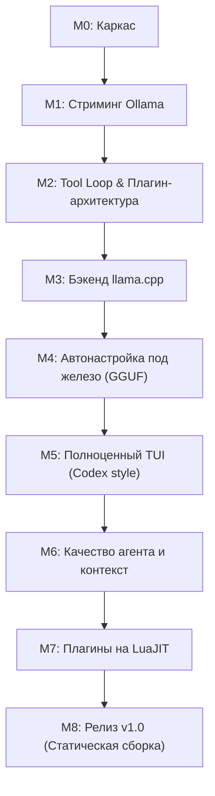

# SKEET Code — Дорожная карта разработки до релиза v1.0

Терминальный агент для программирования на C в духе Claude Code и OpenAI Codex.
Работает с локальными моделями через **Ollama** и **llama.cpp** (с автоподбором параметров запуска под железо).

---

## 1. Архитектурные принципы

1. **Один бинарник (`skeet`):** никаких тяжелых фреймворков и лишних внешних зависимостей.
2. **Нулевой глобальный изменяемый стейт:** всё состояние живет в `SkeetCtx`, передаваемом первым аргументом. Единственное исключение — системный флаг `SIGINT`.
3. **Арена памяти на ход (`Arena`):** scratch-буфер аллоцируется на время одного шага агента и мгновенно сбрасывается (`arena_reset`) без фрагментации кучи.
4. **Строки `(ptr, len)`:** структуры `Str` и потоковые `StrBuf` исключают лишние `malloc`/`strlen`.
5. **Единые реестры и текстовые границы:** инструменты, события и команды регистрируются через один и тот же C-API (с версионированием ABI и `owner`), а обмен данными идет через JSON-строки, что гарантирует тривиальное подключение LuaJIT-плагинов.
6. **Кроссплатформенность:** поддержка Linux, macOS и Windows.

---

## 2. Текущее состояние: Завершённые этапы

### [x] M0. Каркас и базовые структуры данных
- Bump-аллокатор `Arena` с постраничным ростом и сбросом за $O(1)$.
- Строковые срезы `Str` и динамический накопитель `StrBuf`.
- Потокобезопасное файловое логирование `log.c/h`.
- Менеджер конфигурации `config.c/h` (`~/.config/skeet/config.json` по спецификации XDG).
- Кроссплатформенный уровень абстракции путей и файлов `compat.c/h` (`skeet_resolve_path`, `skeet_realpath`).
- Строгая сборка Makefile (`-Wall -Wextra -pedantic -std=c11 -fsanitize=address,undefined`).

### [x] M1. Чат со стримингом токенов (Ollama)
- Абстракция `Backend` (`list_models`, `start`, `chat_stream`, `stop`).
- Однопоточный асинхронный HTTP-клиент на базе `libcurl` (`curl_multi_poll`).
- Потоковый парсер SSE `SseParser` и обертки `cJSON` (`json.c/h`).
- Бэкенд Ollama с опросом `/api/tags` и стримингом `/v1/chat/completions`.
- Безопасная обработка Ctrl+C (`SIGINT` прерывает трансфер без падения программы).
- Локальный mock-сервер для тестирования потокового вывода токенов.

### [x] M2. Цикл агента (Tool Loop) и точки расширения под плагины
- `SkeetCtx`: полное управление контекстом сессии.
- `ToolRegistry` (`src/tools/registry.c/h`): регистрация с ABI `size`, `name`, `schema_json`, флагами `TOOL_READONLY` / `TOOL_NEEDS_CONFIRM`, `userdata` и выгрузкой по `owner`.
- `EventBus` (`src/events.c/h`): шина событий с приоритетами и результатами `EV_CONTINUE`, `EV_DENY`, `EV_MODIFIED`.
- `CommandRegistry` (`src/commands.c/h`): диспетчер слэш-команд (`/help`, `/tools`, `/exit`, `/clear`).
- `PermissionPolicy` (`src/permissions.c/h`): режимы `--ask`, `--yes`, `--readonly`, запоминание решений `[y/n/a]`, колбэк подтверждения.
- `ToolCallAccumulator` (`src/tools/accumulator.c/h`): накопление кусочков `tool_calls` из SSE-потока по индексам.
- Шесть встроенных инструментов:
  - `read_file`: нумерация строк, лимиты 2000 строк / 64 КБ, защита от бинарных файлов, учет прочитанных файлов.
  - `glob`: рекурсивный поиск файлов, фильтрация `.git`/`build`/`node_modules`, лимит 200 результатов.
  - `grep`: поиск по POSIX regex (`файл:строка:текст`), лимит 200 результатов.
  - `edit_file`: точная замена строк, проверка предварительного чтения, атомарная перезапись (`tmp + rename`), генерация цветного диффа.
  - `write_file`: создание родительских папок, атомарная запись, проверка чтения перед перезаписью.
  - `bash`: запуск через `fork + /bin/sh -c`, `poll` stdout/stderr, собственный process group (`setpgid`), гарантированный kill поддерева по таймауту/Ctrl+C, ограничение вывода в 30 КБ.
- Интеллектуальный агент (`src/agent.c`):
  - Цикл «запрос → вызов инструментов → результаты → запрос» до 25 итераций.
  - Превью диффов перед подтверждением.
  - Запасной разбор текстовых вызовов `<tool_call>{...}</tool_call>`.
  - Элегантный терминальный интерфейс в стиле OpenAI Codex.
- 12 автоматических тестов под ASan/LSan.

---

## 3. План последующих этапов до релиза v1.0

---

### [x] M3. Бэкенд llama.cpp
**Цель:** Автономная работа с моделями GGUF через запуск локального `llama-server` без внешних демонов. (Реализовано)

1. **Спавн и жизненный цикл `llama-server` (`src/backend_llama.c`):**
   - Поиск бинарника `llama-server` (в `$PATH`, по пути из конфига или рядом с бинарником `skeet`).
   - Запуск дочернего процесса с переданным путем к GGUF файлу.
   - Изолированная группа процессов (`setpgid`) для предотвращения зомби-процессов.
2. **Health-чек и синхронизация:**
   - Опрос эндпоинта `GET /health` в неблокирующем цикле с таймаутом старта (до 60 секунд для больших моделей).
   - Индикация прогресса загрузки слоев в VRAM.
3. **Интерфейс чата:**
   - Унификация запросов через `/v1/chat/completions` (OpenAI-совместимый API `llama-server`).
   - Использование того же потокового механизма `SseParser` и `ToolCallAccumulator`.
4. **Остановка и очистка:**
   - Graceful shutdown (`SIGINT` -> `SIGTERM` -> `SIGKILL` через 2 секунды при выходе).
5. **Критерии готовности:**
   - Бесшовное переключение бэкенда (`--backend llama` или команда `/backend llama`).
   - Tool loop работает идентично на Ollama и llama.cpp.

---

### [x] M4. Автоподбор параметров под железо (Hardware & GGUF tuning)
**Цель:** Достижение максимального tok/s без ручной настройки флагов запуска `llama-server`. (Реализовано)

1. **Детектор аппаратного обеспечения (`src/tune/hw.c/h`):**
   - **RAM:** чтение доступной и свободной памяти (`sysinfo` / `/proc/meminfo` на Linux, `sysctl` на macOS, `GlobalMemoryStatusEx` на Windows).
   - **CPU:** количество физических ядер (без учета Hyper-Threading) для оптимального `-t`.
   - **GPU & VRAM:**
     - NVIDIA: прямое чтение через `libnvidia-ml.so` (NVML) с fallback на `nvidia-smi`.
     - Apple Silicon: чтение unified memory через `sysctl` (Metal).
     - AMD: чтение sysfs `/sys/class/drm/card*/device/mem_info_vram_total` или `rocm-smi`.
2. **Парсер заголовков GGUF (`src/tune/gguf.c/h`):**
   - Чтение заголовка файла `.gguf` без загрузки тензоров в RAM.
   - Извлечение метаданных: архитектура, количество слоев (`llm.block_count`), головы внимания, размер скрытого состояния, размер KV-кэша, тип квантования весов, параметры MoE (количество экспертов, активных экспертов).
3. **Калькулятор параметров (`src/tune/tune.c/h`):**
   - Расчет числа слоев на GPU (`-ngl / --n-gpu-layers`): расчет размера весов одного слоя + размер KV-кэша на контекст; втискивание максимума в доступный VRAM с запасом 512 МБ под ОС.
   - Оптимальный размер контекста (`-c / --ctx-size`): выбор между запрошенным пользователем и доступной памятью.
   - Квантование KV-кэша (`-ctk q8_0 -ctv q8_0` при дефиците памяти).
   - Flash Attention (`-fa`) при поддержке архитектуры.
   - Для MoE моделей: при нехватке VRAM расчет частичной выгрузки экспертов на CPU.
4. **Кэширование настроек:**
   - Сохранение вычисленных параметров в `~/.cache/skeet/tune.json` по ключу `hash(модель_путь + объем_VRAM)`.
   - Ручное переопределение флагов через секцию `"llama_flags"` в конфиге.

---

### Этап M5. Полноценный TUI (OpenAI Codex / Claude Code стиль)
**Цель:** Удобная работа в терминале без мерцания, с поддержкой интерактивного скролла, подсветки диффов и многострочного ввода.

1. **Управление терминалом (`src/tui/term.c/h`):**
   - Raw mode через `termios` (POSIX) / `SetConsoleMode` (Windows).
   - Переключение на альтернативный экран (alt screen buffer) и возврат при выходе.
   - Обработка `SIGWINCH` и пересчет размеров экрана.
2. **Компонент отображения (`src/tui/view.c/h`):**
   - Двунаправленный скролл истории сообщений и вывода инструментов клавишами `PgUp`/`PgDn`/стрелками.
   - Рендеринг блоков инструментов с рамками Unicode (`╭─`, `│`, `╰─`).
   - Синтаксическая подсветка кода и диффов (красный/зеленый с фоном).
   - Статус-бар внизу экрана: текущая модель, бэкенд, заполнение контекстного окна, tok/s, индикатор занятости.
3. **Редактор строки ввода (`src/tui/input.c/h`):**
   - Полноценное редактирование: стрелки влево/вправо, `Home`/`End`, `Backspace`/`Delete`.
   - История команд (стрелки вверх/вниз) с сохранением между сессиями (`~/.local/state/skeet/history`).
   - Автодополнение слэш-команд по `Tab` и путей к файлам.
   - Поддержка вставки многострочного текста.

---

### Этап M6. Интеллект агента и управление контекстом
**Цель:** Длинные диалоговые сессии без переполнения контекста модели и деградации инструкций.

1. **Системный контекст проекта:**
   - Автоматический поиск и загрузка файла `SKEET.md` из корня проекта.
   - Инъекция информации о репозитории (git branch, компилятор, ОС, дерево ключевых файлов).
2. **Контекстный менеджер (Context Compactor):**
   - Токенизатор / эвристический счетчик токенов.
   - Ограничение окна контекста (например, при достижении 80% от лимита модели):
     - Удаление полных тел старых `tool` вызовов с заменой на сжатое резюме `[read_file: 200 lines summarized]`.
     - Суммаризация ранних ходов диалога в системную память агента.
3. **Управление сессиями:**
   - Команды `/session save <name>`, `/session load <name>`, `/session list`.
   - Автосохранение последней сессии в `~/.local/state/skeet/sessions/`.
4. **Слэш-команды настройки агента:**
   - `/model <name>`: смена модели на лету.
   - `/backend <ollama|llama>`: переключение провайдера.
   - `/tune`: вывод диагностической информации о железе и текущих флагах.
   - `/compact`: принудительное сжатие контекста.

---

### Этап M7. Система плагинов на LuaJIT
**Цель:** Возможность расширения функционала без перекомпиляции бинарника.

1. **Встраивание LuaJIT:**
   - Подключение `libluajit-5.1` через C API и LuaJIT FFI.
2. **Мост `skeet.*` в Lua:**
   - `skeet.register_tool({ name = "...", description = "...", schema = {...}, run = function(args) ... end })`
   - `skeet.on("BEFORE_TOOL", function(ev) ... end)`
   - `skeet.register_command("/mycmd", function(args) ... end)`
3. **Каталоги плагинов:**
   - Системные: `~/.config/skeet/plugins/*.lua`
   - Локальные для проекта: `.skeet/plugins/*.lua`
4. **Безопасная изоляция:**
   - Выгрузка плагинов через `tool_unregister_owner`, `event_unsubscribe_owner`.

---

### Этап M8. Релиз v1.0, оптимизация и дистрибуция
**Цель:** Готовый к промышленной эксплуатации продукт.

1. **Статическая сборка:**
   - Сборка с `musl` на Linux (полностью статичный бинарник без libc зависимостей).
   - Нативные сборки под macOS (Universal binary: Apple Silicon + Intel).
   - Нативная сборка под Windows (x86_64, статический CRT).
2. **Производительность:**
   - Компиляция с `-O3 -flto -march=native` (для локальной сборки) и `-O3` для релизных бинарников.
   - Профилирование через `perf` и `valgrind` (massif).
3. **Документация и дистрибуция:**
   - Man-страница `skeet(1)`.
   - GitHub Actions CI/CD матрица: автоматическая сборка релизов под Linux, macOS, Windows.
   - Скрипт быстрой установки `curl -sSL https://... | sh`.

---

## 4. Сводная таблица релизных вех

| Версия | Майлстоун | Ключевая функциональность | Статус |
|---|---|---|---|
| **v0.1.0** | **M0 + M1** | Каркас, арена, HTTP SSE, стриминг Ollama, Ctrl+C | **Завершено** |
| **v0.2.0** | **M2** | Tool Loop (6 инструментов), шина событий, права, Codex CLI | **Завершено** |
| **v0.3.0** | **M3** | Автономный бэкенд llama.cpp (спавн llama-server, health) | **Завершено** |
| **v0.4.0** | **M4** | Автоподбор под железо (NVML, GGUF parser, авто-ngl/ctx) | *Следующий этап* |
| **v0.5.0** | **M5** | Полноэкранный TUI, alt screen, скролл истории, подсветка | Запланировано |
| **v0.6.0** | **M6** | Качество агента, сжатие контекста, чтение SKEET.md, сессии | Запланировано |
| **v0.7.0** | **M7** | Плагины на LuaJIT (FFI, skeet.* API) | Запланировано |
| **v1.0.0** | **M8** | Релиз v1.0: статическая сборка, кроссплатформа, CI/CD | Запланировано |
